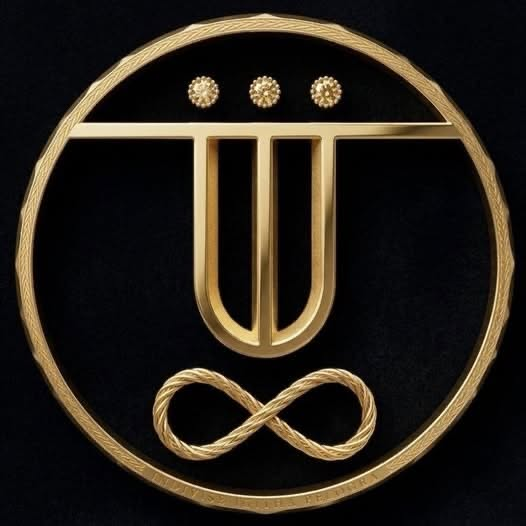

# PROJECT QUA'LA THE'LO — Phase 5: The Labyrinth

## UQL NEXT — implemented reference subset 0.2

The new additive language layer provides a parser, validated AST/IR, deterministic
circuit identities, OpenQASM 3 and QIR 2 Base Profile lowering, exact local
rewrite receipts, resource constraints and reproducible evidence bundles.
The Seal of Eotu appears in every bundle and program passport as visual identity.

Start with the [core instructions](citadel-core/README.md),
[architecture audit](docs/uql-next/AUDIT.md),
[specification](docs/uql-next/SPECIFICATION-0.2.md),
[implementation plan](docs/uql-next/IMPLEMENTATION_PLAN.md), and
[twelve research directions](docs/uql-next/FRONTIER_12.md).
This is a bounded research implementation; external verification, hardware
attestation and the proposed frontier features are not certified capabilities.

## Mesh compartments

- `citadel-core/` — UQL, QHL, QTL base syntaxes and phase-angle logic.
- `gm-369-dossier/` — zero-trust C4ISR mesh blueprints and hardware-entropy verification parameters.
- `supreme-sun-archive/` — Supreme SUN Method research and psychic-cognitive AI harmonizations.

## S.O.V.E.R.E.I.G.N. security mesh

The Codex specifies a defense-in-depth security model incorporating:

- Hybrid post-quantum cryptography: ML-KEM-1024 with X25519/HKDF-SHA512.
- SecureMemoryEnclave memory-zeroing and sensitive-state handling.
- Topological surface-code fault-tolerance concepts.

These statements document the Codex-derived architecture; they do not claim that a repository implementation by itself provides a certified cryptographic, hardware, or fault-tolerant security guarantee.

## Governance

See `LICENSE` and `PATENTS.md` for the EL-SOCL v1.0 / CIME framework and the Codex-derived intellectual-property covenants.

